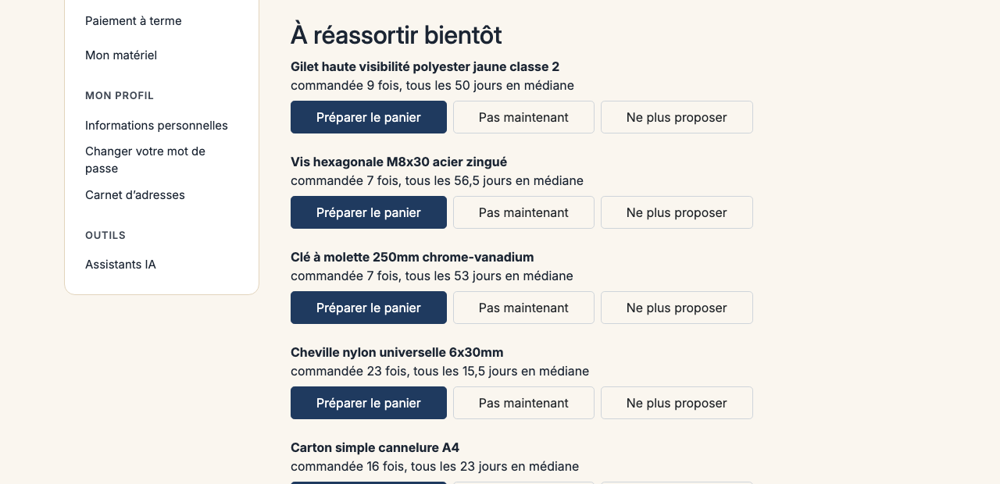

# Sylius B2B Predictive Analytics Plugin

> English: [README.md](README.md) <!-- vitrine:lang -->

Analyse prédictive de réassort pour [Sylius](https://sylius.com) 2 B2B : calcule les rythmes de réassort par entreprise et référence produit pour anticiper les besoins d'achat avant la rupture de stock.

Construit sur [`tmonier/sylius-company-accounts-plugin`](https://github.com/thibmonier/sylius-company-accounts-plugin) (entreprises, membres, rôles) et [`tmonier/sylius-company-insights-plugin`](https://github.com/thibmonier/sylius-company-insights-plugin) (tableau de bord des achats).

## Ce qu'il fait

- **Calcul d'intervalle médian** : analyse l'historique de commandes pour déterminer le rythme d'achat typique de chaque référence par entreprise
- **Prédiction explicable** : conserve l'explication du calcul (« commandée 5 fois, tous les 28 jours en médiane »)
- **Date de réassort attendue** : estime la prochaine date de commande selon le rythme habituel
- **Alertes de réassort dans l'espace client** : affiche un bloc « À réassortir bientôt » pour les références dont la date de réassort attendue tombe dans les **7 prochains jours** (y compris les références en retard jusqu'à un intervalle médian)
- **Pré-remplissage du panier** : bouton « Préparer le panier » qui ajoute la quantité médiane habituelle au panier
- **Masquer les alertes** : boutons « Pas maintenant » (temporaire) ou « Ne plus proposer » (définitif)
- **Commande de recalcul** : mise à jour de toutes les prédictions avec une commande planifiable
- **Score d'attrition explicable dans l'admin** : indique sur la fiche entreprise lesquelles ralentissent leurs commandes, avec la raison en clair, et un filtre dans la liste des entreprises

## Prérequis

- PHP 8.2 ou supérieur
- Sylius 2.2.9 ou 2.3+
- [`tmonier/sylius-company-accounts-plugin`](https://github.com/thibmonier/sylius-company-accounts-plugin) ^1.1 installé
- [`tmonier/sylius-company-insights-plugin`](https://github.com/thibmonier/sylius-company-insights-plugin) ^0.2 installé

## Installation

```bash
composer require tmonier/sylius-b2b-predictive-analytics-plugin
```

1. Activer le plugin dans `config/bundles.php` :

    ```php
    Tmonier\SyliusPredictiveAnalyticsPlugin\TmonierSyliusPredictiveAnalyticsPlugin::class => ['all' => true],
    ```

2. Exécuter les migrations pour créer la table des prédictions :

    ```bash
    php bin/console doctrine:migrations:migrate
    ```

3. Importer les routes dans `config/routes.yaml` :

    ```yaml
    tmonier_predictive:
        resource: '@TmonierSyliusPredictiveAnalyticsPlugin/config/routes.yaml'
    ```

4. Importer la configuration du plugin (services, hooks Twig, filtre de la grille des entreprises), par exemple dans `config/packages/tmonier_predictive.yaml` :

    ```yaml
    imports:
        - { resource: '@TmonierSyliusPredictiveAnalyticsPlugin/config/config.yaml' }
    ```

## Usage

### Alertes de réassort dans l'espace client

Le plugin affiche automatiquement un bloc « À réassortir bientôt » dans l'espace client pour les références dont la date de réassort attendue tombe dans les **7 prochains jours** (y compris les références en retard jusqu'à un intervalle médian).

Chaque alerte propose :
- Un bouton **« Préparer le panier »** qui pré-remplit le panier avec la quantité médiane habituelle
- Un bouton **« Pas maintenant »** pour masquer temporairement l'alerte
- Un bouton **« Ne plus proposer »** pour masquer définitivement cette référence

Le cloisonnement par entreprise est strict : un acheteur ne voit que les alertes de son entreprise.

### Calculer une prédiction

```php
use Tmonier\SyliusPredictiveAnalyticsPlugin\Calculator\PredictiveReorderCalculatorInterface;

$prediction = $calculator->calculate($variant, $company);

if ($prediction->isPredicted()) {
    echo $prediction->explanation; // "ordered 5 times, every 28 days on median"
    echo $prediction->expectedReorderDate->format('Y-m-d'); // Expected next reorder date
} else {
    echo $prediction->explanation; // "insufficient history: ordered 1 time, 3 orders needed"
}
```

### Recalcul planifié

Le plugin inclut une commande pour recalculer toutes les prédictions :

```bash
php bin/console tmonier:predictive:recalculate
```

Cette commande peut être planifiée quotidiennement via cron :

```cron
0 2 * * * cd /path/to/project && php bin/console tmonier:predictive:recalculate
```

### Score d'attrition dans l'admin

La fiche entreprise de l'admin affiche un bloc **« Rythme de commande »**, et la liste des entreprises reçoit un filtre **« Rythme de commande »** (actif, à risque, critique). Le bloc donne le statut, la raison en clair et la mention « indicatif ». Exemple : *« commande tous les 21 jours, rien depuis 47 jours »*.

Le score est calculé à partir des commandes déjà présentes dans la boutique : aucune donnée personnelle supplémentaire n'est collectée, et le chiffre est une estimation à confirmer avec le client, pas une décision.

**Règle** (mêmes commandes que le tableau de bord d'achats : terminées, non annulées, non en attente d'approbation) :

| Situation | Statut |
|-----------|--------|
| Moins de 4 commandes sur les 12 derniers mois | Historique insuffisant, sans score |
| Première commande il y a moins de 6 mois (entreprise nouvelle ou saisonnière) | Aucun statut d'alerte affiché |
| Délai depuis la dernière commande d'au plus 2 fois l'intervalle médian entre commandes | Actif |
| Délai depuis la dernière commande de plus de 2 fois l'intervalle médian | À risque |
| Délai depuis la dernière commande de plus de 3 fois l'intervalle médian | Critique |

**Permission.** Le cœur de Sylius n'a pas de permission par ressource : ses routes d'admin `permission: true` interrogent le service défini dans `sylius_resource.authorization_checker`, qui autorise tout par défaut. Le bloc d'attrition et le filtre interrogent ce même service avec la permission `tmonier_company_accounts.company.show`. Un projet qui y branche son propre contrôle d'autorisation décide qui voit le score ; sans cela, tout administrateur qui peut ouvrir la fiche entreprise le voit.

## Captures d'écran

Le bloc « À réassortir bientôt » du compte client, dans la [démo Sylius B2B](https://sylius-b2b.thibaut-monier.fr/fr_FR/plugins) :



## Règles de calcul

- **Minimum 3 commandes** : une prédiction nécessite au moins 3 commandes complétées
- **Commandes comptées** : seules les commandes complétées et non annulées sont prises en compte
- **Médiane robuste** : la médiane n'est pas faussée par les valeurs extrêmes, contrairement à la moyenne
- **Cloisonnement** : chaque entreprise a ses propres prédictions, sans mélange

<!-- vitrine:demo-b2b:start -->
## Démo B2B

Ce plugin est utilisé dans la [démo B2B Sylius](https://github.com/thibmonier/sylius-b2b-demo) : une boutique Sylius 2.3 avec des données d'exemple fictives, où les plugins B2B fonctionnent ensemble. Le code source, l'installation et les fixtures de la démo sont dans ce dépôt.

- Démo en ligne : [sylius-b2b.thibaut-monier.fr](https://sylius-b2b.thibaut-monier.fr)
- Auteur : [Thibaut Monier](https://www.linkedin.com/in/thibautmonier/)

La démo est un exemple, pas une configuration de production.
<!-- vitrine:demo-b2b:end -->

## Licence

MIT
