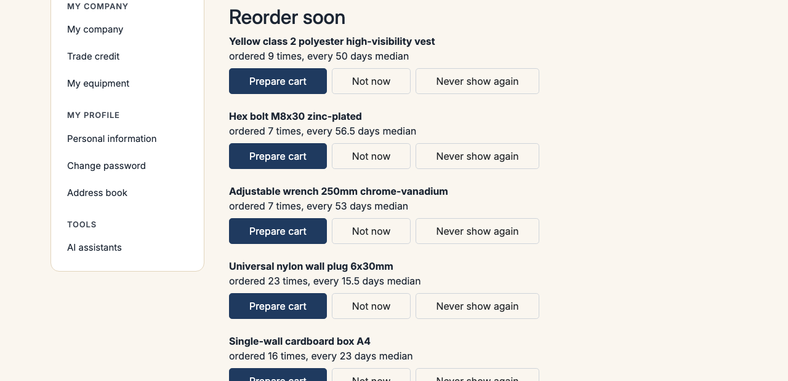

# Sylius B2B Predictive Analytics Plugin

> Français : [README.fr.md](README.fr.md) <!-- vitrine:lang -->

Predictive reorder analytics for [Sylius](https://sylius.com) 2 B2B: calculates reorder patterns per company and product reference to anticipate purchase needs before stock runs out.

Built on [`tmonier/sylius-company-accounts-plugin`](https://github.com/thibmonier/sylius-company-accounts-plugin) (companies, members, roles) and [`tmonier/sylius-company-insights-plugin`](https://github.com/thibmonier/sylius-company-insights-plugin) (purchasing dashboard).

## What it does

- **Median interval calculation**: analyzes order history to determine the typical purchase rhythm for each product reference per company
- **Explainable prediction**: keeps the calculation explanation ("ordered 5 times, every 28 days on median")
- **Expected reorder date**: estimates the next order date based on usual rhythm
- **Reorder alerts in customer account**: displays a "To reorder soon" block for products with expected reorder date within the next **7 days** (including overdue items up to one median interval)
- **Pre-fill cart**: "Prepare cart" button adds the typical median quantity to cart
- **Dismiss alerts**: "Not now" (temporary) or "Don't suggest again" (permanent) buttons
- **Recalculation command**: updates all predictions with a schedulable command

## Prerequisites

- PHP 8.2 or higher
- Sylius 2.2.9 or 2.3+
- [`tmonier/sylius-company-accounts-plugin`](https://github.com/thibmonier/sylius-company-accounts-plugin) ^1.1 installed
- [`tmonier/sylius-company-insights-plugin`](https://github.com/thibmonier/sylius-company-insights-plugin) ^0.2 installed

## Installation

```bash
composer require tmonier/sylius-b2b-predictive-analytics-plugin
```

1. Enable the plugin in `config/bundles.php`:

    ```php
    Tmonier\SyliusPredictiveAnalyticsPlugin\TmonierSyliusPredictiveAnalyticsPlugin::class => ['all' => true],
    ```

2. Run migrations to create the predictions table:

    ```bash
    php bin/console doctrine:migrations:migrate
    ```

3. Import the routes in `config/routes.yaml`:

    ```yaml
    tmonier_predictive:
        resource: '@TmonierSyliusPredictiveAnalyticsPlugin/config/routes.yaml'
    ```

## Usage

### Reorder alerts in customer account

The plugin automatically displays a "To reorder soon" block in the customer area for product references with expected reorder date within the next **7 days** (including overdue items up to one median interval).

Each alert offers:
- **"Prepare cart"** button that pre-fills the cart with the usual median quantity
- **"Not now"** button to temporarily hide the alert
- **"Don't suggest again"** button to permanently hide this product

Company isolation is strict: a buyer only sees alerts from their own company.

### Calculate a prediction

```php
use Tmonier\SyliusPredictiveAnalyticsPlugin\Calculator\PredictiveReorderCalculatorInterface;

$prediction = $calculator->calculate($variant, $company);

if ($prediction->isPredicted()) {
    echo $prediction->explanation; // "ordered 5 times, every 28 days on median"
    echo $prediction->expectedReorderDate->format('Y-m-d'); // Expected next reorder date
} else {
    echo $prediction->explanation; // "insufficient history: ordered 1 time, 3 orders needed"
}
```

### Scheduled recalculation

The plugin includes a command to recalculate all predictions:

```bash
php bin/console tmonier:predictive:recalculate
```

This command can be scheduled daily via cron:

```cron
0 2 * * * cd /path/to/project && php bin/console tmonier:predictive:recalculate
```

## Screenshots

The "Reorder soon" block of the customer account, in the [Sylius B2B demo](https://sylius-b2b.thibaut-monier.fr/en_US/plugins):



## Calculation rules

- **Minimum 3 orders**: a prediction requires at least 3 completed orders
- **Counted orders**: only completed and non-cancelled orders are taken into account
- **Robust median**: the median is not skewed by extreme values, unlike the average
- **Company isolation**: each company has its own predictions, with no mixing

<!-- vitrine:demo-b2b:start -->
## B2B demo

This plugin is used in the [Sylius B2B demo](https://github.com/thibmonier/sylius-b2b-demo): a Sylius 2.3 shop with fictitious sample data where the B2B plugins work together. The source code, setup and fixtures of the demo are in that repository.

- Online demo: [sylius-b2b.thibaut-monier.fr](https://sylius-b2b.thibaut-monier.fr)
- Author: [Thibaut Monier](https://www.linkedin.com/in/thibautmonier/)

The demo is an example, not a production setup.
<!-- vitrine:demo-b2b:end -->

## License

MIT
